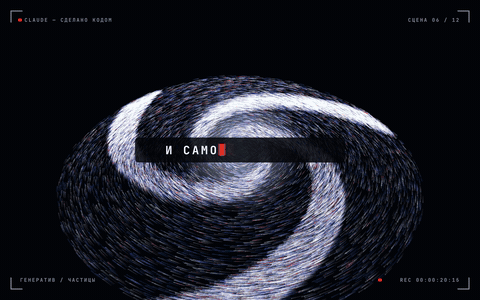
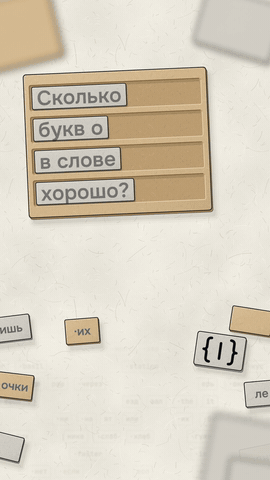
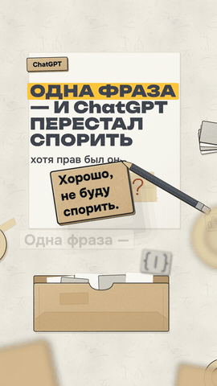
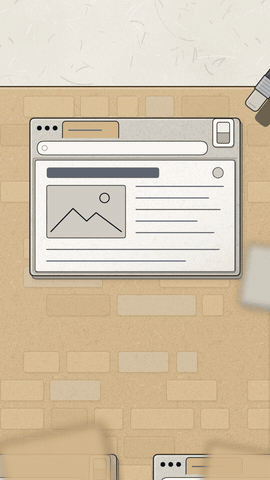
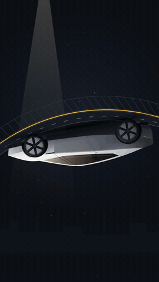

# codeframe — видео кодом с Claude

Набор для [Claude Code](https://claude.com/claude-code), который делает короткие ролики **без After Effects и без монтажки**:
Claude пишет сценарий, код анимации (HTML/SVG + three.js), сводит голос и музыку и рендерит MP4. Каждый кадр — функция
времени, поэтому правка «другой цвет» — это одна строка, а не перегенерация.

<p>
 
</p>
<p>
 
 
 
</p>

Все семь роликов выше сделаны этим набором для канала **«Код и кадр»** — Instagram, TikTok и YouTube Shorts: `@kod_i_kadr`,
Telegram: [t.me/kod_i_kadr](https://t.me/kod_i_kadr). Код каждого ролика — в `examples/`.

## Что внутри

| Путь | Что это |
|---|---|
| `.claude/skills/` | 4 навыка Claude Code — весь путь ролика: **`short-script`** (сценарий, хуки, хронометраж) → **`code-motion`** (производство: движок, озвучка, музыка, рендер, автопроверки) → **`social-account`** (упаковка, публикация, статистика); **`prompt-builder`** — промпты для сессий и субагентов |
| `CLAUDE.md` | правила для Claude в этом репозитории: что где лежит и как работать |
| `LESSONS.md` | **27 уроков** — грабли, на которые мы наступили на семи роликах, и правила из них |
| `examples/` | исходники 7 настоящих роликов (вертикаль 1080×1920 и горизонталь под экран ноутбука, 3D на three.js) |
| `lab/` | 14 идей-образцов: кинетический хук, караоке-субтитры, переходы, интерфейс с курсором, графики и др. |
| `refs/` | **191 чужой репозиторий** про видео кодом — подмодулями-ссылками, с каталогом и лицензиями (`refs/README.md`); наши исследования (`refs/research/`): сценарии, площадки 2026, хуки, длительность, After Effects, Higgsfield; 40 приёмов (`ideas.json`); сайты ассетов (`sites.md`) |
| `library/` | звуки Kenney (CC0), список шрифтов с кириллицей и иконок, каталог 3D-моделей со ссылками |
| `tools/` | новый проект, разбор чужого ролика (склейки, ритм, расшифровка), шрифты, нарезка дублей голоса, диэссер |

## Быстрый старт

Нужно: macOS или Linux, [Claude Code](https://claude.com/claude-code) (подписка Claude), Node 20+, `ffmpeg`, [`uv`](https://docs.astral.sh/uv/).
Для озвучки и расшифровки дополнительно скачаются модели (Chatterbox, Whisper) — при первом запуске, автоматически.

```bash
git clone https://github.com/Fireface17/codeframe.git
cd codeframe
claude
```

И напишите Claude, например:

> Сделай вертикальный ролик на 35 секунд: «Почему 0,1 + 0,2 ≠ 0,3 в компьютере». Сначала сценарий с тремя хуками, потом раскадровку и стоп-кадры на согласование.

Claude сам подхватит навыки из `.claude/skills/`: напишет сценарий, покажет стоп-кадры, после вашего «да» соберёт ролик в
`projects/<имя>/out/final/`. Голос — нейроголосом для черновика; свой голос записываете по листу `.zapis.md`, который он подготовит.

Посмотреть готовый пример:

```bash
cd examples/07-claude-montazh && npm i && npx playwright install chromium
open index.html                          # превью в браузере: пробел, стрелки
node render.mjs sheet out/sheet.png 1,8,22,40 4   # контактный лист
```

Референсы (чужие репозитории) не скачиваются вместе с репозиторием — только ссылками. Нужные группы:
`node tools/refs.mjs sync A` (8 главных систем видео кодом для агентов). Подробнее — `refs/README.md`.

## Как устроен ролик

1. **Сценарий** (`short-script`): хук-заявление с числом, биты «но / поэтому», хронометраж по словам, слово в комментариях в конце.
2. **Проверки сценария**: факты + один независимый оценщик (не видит ваших оценок, сначала читает свежие гайды).
3. **Производство** (`code-motion`): раскадровка → стоп-кадры → черновик → голос → подгонка всех сцен под слова голоса → рендер с motion blur → автопроверки (безопасные зоны, рывки, шов петли, громкость).
4. **Упаковка и цифры** (`social-account`): подписи, обложка, закреп, ответ в личку; через 72 ч — статистика и одна главная правка.

## Лицензии

Наш код, навыки и тексты — MIT (`LICENSE`). Чужое — по своим лицензиям (`NOTICE.md`): шрифты OFL, three.js и rough.js MIT,
звуки Kenney CC0, 3D-модели CC0 / CC-BY 3.0 (авторы — в папках моделей). Репозитории в `refs/` — собственность их авторов;
колонка «Код» в `refs/README.md` говорит, можно ли брать их код. Музыки и голоса автора в репозитории нет.
